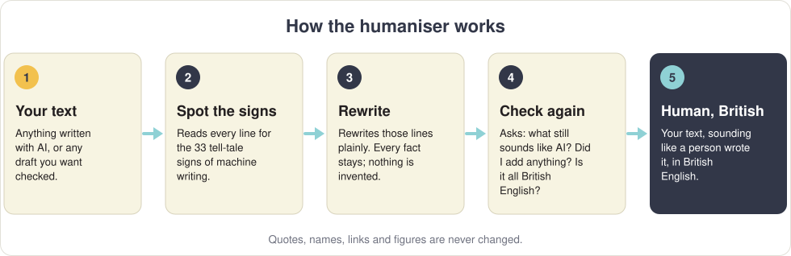
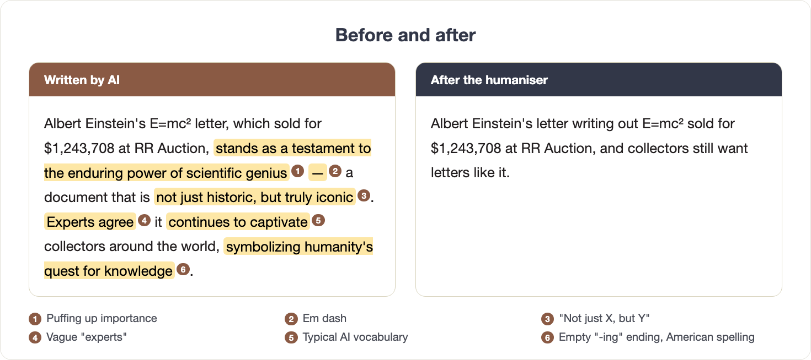
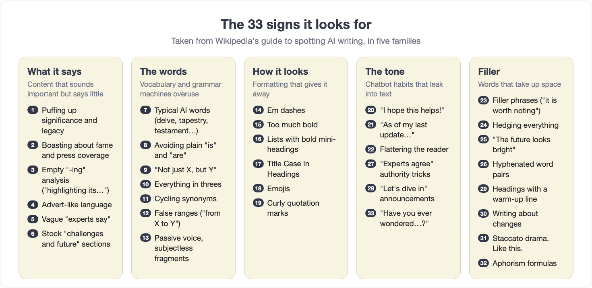

# Humaniser

**Makes writing produced with AI read like a person wrote it, and always in British English.**

> [!IMPORTANT]
> **The rule:** if you create any content with AI, for whatever reason, run it through the humaniser before it goes anywhere: the website, a newsletter, social media, a client or Dan. No exceptions.

---

## Why it exists

Text written by AI has habits: certain words, certain sentence shapes, a certain way of puffing things up. Once you know them, they're easy to spot, by people and by software.

**This skill is meant to stop search engines from identifying our writing as AI-generated**, and to make sure everything we publish reads as if a person wrote it, because a person stands behind it. It finds those habits and rewrites them out, keeping every fact exactly as it was.

---

## Before and after

The rewrite keeps every fact (the letter, the price, the auction house) and drops everything that only *sounded* important. It adds nothing: no new names, numbers or claims.

---

## How it works, step by step

**1. It reads your text for the 33 signs of AI writing.** The list comes from Wikipedia's guide to spotting AI writing, which its editors built from thousands of real examples.

**2. It rewrites what it found, plainly.** Puffed-up phrases become plain statements. Vague "experts say" either gets a real source from your text or goes. Sentences change length the way a person's do. Paragraphs can be merged or split.

**3. It never invents anything.** Every fact in your text survives, and nothing new comes in: no name, number, date, quote or source that wasn't in what you gave it. If a sentence needs a detail you didn't supply, it asks you for it or writes the plain version without it, rather than making one up.

**4. It never touches protected text.** Quotations, names, titles of works, links, figures and code stay exactly as they are.

**5. It turns everything into British English.** Spelling, words, grammar and punctuation:

| American | British |
| --- | --- |
| organize, realize, color | organise, realise, colour |
| sidewalk, gasoline, elevator, apartment | pavement, petrol, lift, flat |
| a license (the noun) | a licence (*license* stays as the verb) |
| Mr. Smith, Dr. Jones | Mr Smith, Dr Jones |
| period (the mark) | full stop |

Some words are decided by meaning, not by country: *programme* is a TV show but a computer *program*; *practice* is the noun and *practise* the verb. It knows the difference. And it doesn't overdo it: no "quid", "telly" or "bloke" to sound British.

**6. It checks its own work.** Before giving you anything, it asks itself three questions:

- *What still makes this sound like AI?*
- *Did I state any fact, name, number or date that wasn't in the original?*
- *Is every word and mark of punctuation British English?*

Then it fixes what those questions turn up and gives you the final version.

**7. It leaves human writing alone.** Specific, unusual details, mixed feelings, asides, sentences of different lengths: those are signs a real person wrote it, so it keeps them rather than smoothing them away.

---

## It knows what kind of writing it's working on

The right voice for a sales letter is wrong for an article. The humaniser has a setting for each kind of writing we do:

| Writing | How it treats it |
| --- | --- |
| **Articles** (memorabilia, coins and collectibles) | Plain, neutral reporting: one specific fact per sentence, no first person, no rhetorical questions. It keeps your word count rather than cutting it down. |
| **Sales letters** | The Paul Fraser Collectibles house style: conversational, short sentences, easy words, like two friends talking in the pub. Short sentences are allowed here; flattering the reader and hedging are not. |
| **Market reports** | Each section in its own voice: plain reporting for the market sections, simple instructions for getting started, Paul's own voice for the expert view, and honest selling only in the closing sections. |

Anything else gets the general rules.

---

## How to use it

Open the Claude app, go to the **Code** tab, and do one of these:

**Paste your text.** The easiest way, from Word, Google Docs or anywhere else.

> */humaniser* and paste your text underneath.

You get a first rewrite, a short list of what still sounded like AI, and the final version. Copy the final version back into your document.

**Point it at a file.** For a Markdown or text file:

> */humaniser Humanise the file "Coins article.md"*

It rewrites the file in place, so it ends up holding only the final version.

**Use it while writing.** Ask for something to be written *with* the humaniser, and its rules are applied as the text is written, then checked once more at the end:

> *Write a 200-word newsletter intro about the coin market and use the humaniser.*

---

## Installing it

1. **Download it.** On the [skill's GitHub page](https://github.com/CollectingDaily/claude-humaniser), click the green **Code** button, then **Download ZIP**.
2. **Install it.** Open the Claude app, click **Code**, choose any folder, drag the ZIP into the message box and type: *Install this skill as a personal skill.* Click **Allow** when asked.
3. **Restart.** Close the Claude app and open it again. Type **/** and look for **humaniser** in the list.

Nothing else to install. It works on Mac and Windows.

---

## Questions

**Can it promise search engines won't flag my text?**
No tool can promise that. It removes the patterns that give AI writing away. Always read the result yourself before it goes out.

**Will it change my facts or figures?**
No. Figures, names, quotes and links are protected, and it checks that it hasn't added anything. If you spot a change to a fact, don't use that version, and tell us.

**I wrote it myself. Should I still run it?**
You can, and it's a good habit for anything important. But the rule is about AI: anything made with AI must go through it.

**My text was in American English. Is that a sign of AI?**
No. American spelling just means an American spellchecker. It gets converted to British English, but it doesn't count as a sign of AI.

**Why does it remove dashes like this one — ?**
Long dashes are one of the clearest signs of AI writing. Commas, full stops, colons or brackets do the same job.

---

<strong>All 33 signs, with examples</strong>

| # | Sign | What it looks like | What the humaniser does |
| --- | --- | --- | --- |
| 1 | Puffing up significance | "a pivotal moment that cemented its legacy" | States what happened, plainly |
| 2 | Boasting about fame | "widely covered by major outlets" | Keeps the coverage only if it's specific and true |
| 3 | Empty "-ing" analysis | "…, highlighting its importance" | Cuts the tail or says what it means |
| 4 | Advert-like language | "nestled in the heart of", "breathtaking" | Plain description |
| 5 | Vague attributions | "experts say", "many believe" | Names the source from your text, or cuts it |
| 6 | Stock "challenges and future" sections | "Despite challenges, the future looks promising" | Removes the formula |
| 7 | Typical AI words | delve, tapestry, testament, landscape, boasts | Everyday words |
| 8 | Avoiding "is" and "are" | "serves as", "stands as" | "is" |
| 9 | "Not just X, but Y" | "not just rare, but iconic" | Says the one thing that's true |
| 10 | Everything in threes | "fast, reliable and secure" | Lists as many as there really are |
| 11 | Cycling synonyms | the coin… the piece… the specimen… the artefact | Sticks to one word |
| 12 | False ranges | "from beginners to seasoned collectors" | Says who is actually meant |
| 13 | Passive voice and fragments | "Mistakes were made." | Says who did it |
| 14 | Em dashes | "the sale — a record — made headlines" | Commas, full stops or brackets |
| 15 | Too much bold | **bold** on every other phrase | Bold only where it helps |
| 16 | Lists with bold mini-headings | "**Rarity:** … **Condition:** …" | Proper sentences where they read better |
| 17 | Title Case In Headings | "The Market In 2026" | "The market in 2026" |
| 18 | Emojis | 🚀 ✨ in headings | Removed |
| 19 | Curly quotation marks | “like this” | Straight quotation marks |
| 20 | Chatbot leftovers | "I hope this helps!", "Great question" | Removed |
| 21 | Knowledge-cutoff disclaimers | "As of my last update…" | Removed |
| 22 | Flattering the reader | "As a discerning collector, you'll appreciate…" | Removed |
| 23 | Filler phrases | "It is worth noting that", "In order to" | Cut |
| 24 | Hedging everything | "could potentially perhaps" | Says it or doesn't |
| 25 | "The future looks bright" | generic upbeat endings | Ends on the last real point |
| 26 | Hyphenated word pairs | "high-quality, well-known, long-term" in a row | Fewer, plainer words |
| 27 | Authority tricks | "Experts agree", "Studies show" | A real source or nothing |
| 28 | Announcements | "Let's dive in", "Here's what you need to know" | Gets straight to it |
| 29 | Fragmented headers | a heading followed by a line that just repeats it | Cuts the warm-up line |
| 30 | Writing about changes | "This was added to replace the old approach…" | Describes the thing as it is |
| 31 | Staccato drama | "It sold. For millions. In minutes." | Normal sentences |
| 32 | Aphorism formulas | "Rarity isn't everything. Provenance is." | Plain statement |
| 33 | Rhetorical openers | "Have you ever wondered…?" | Starts with the point |

---

## Credits

Based on the [humanizer](https://github.com/blader/humanizer) skill by blader, Copyright (c) 2025 Siqi Chen, used under the MIT licence (see [`LICENSE`](LICENSE)). The 33 signs come from Wikipedia's [Signs of AI writing](https://en.wikipedia.org/wiki/Wikipedia:Signs_of_AI_writing), maintained by WikiProject AI Cleanup. This edition adds British English throughout and the settings for articles, sales letters and market reports.
